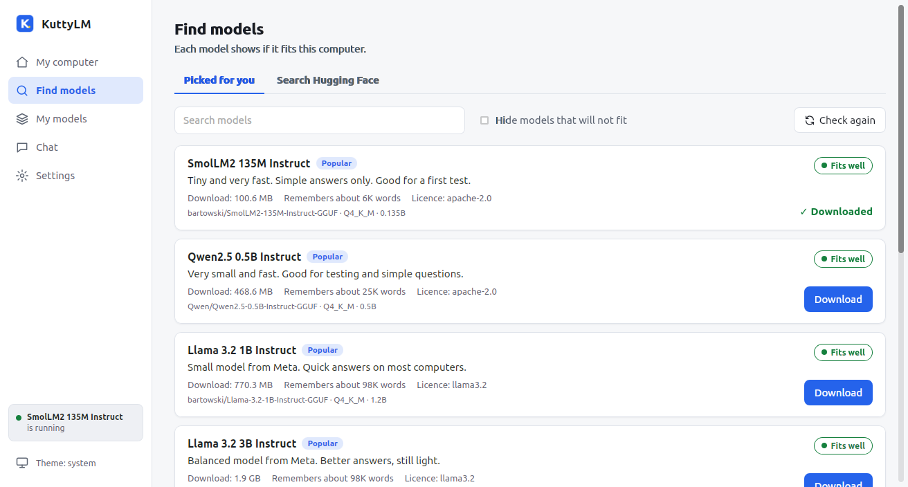
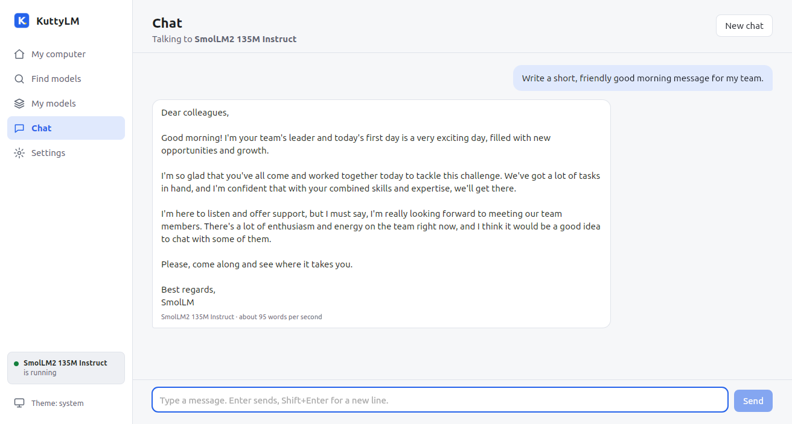
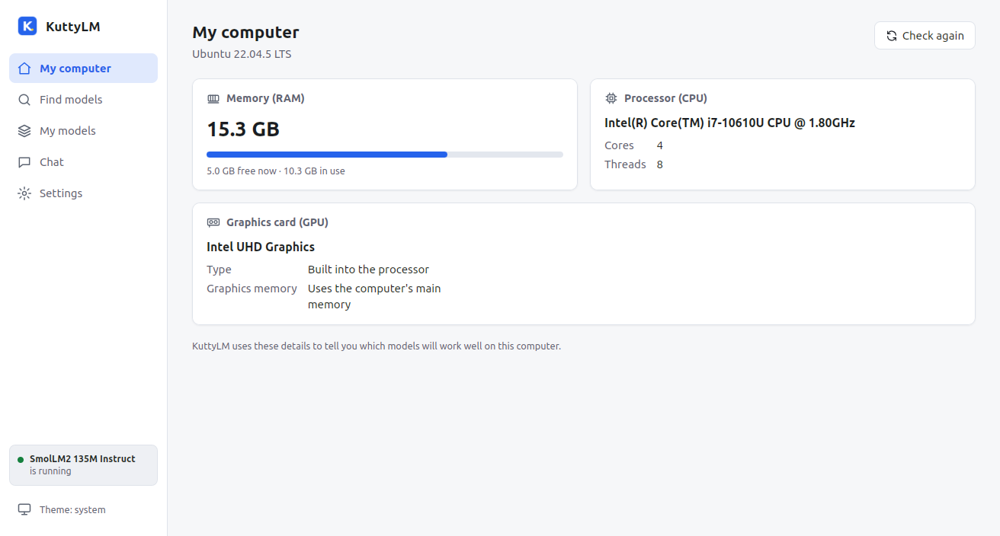
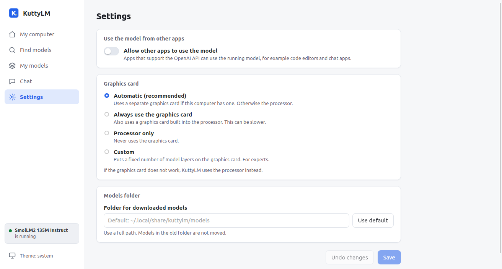

  

<h1 align="center">KuttyLM</h1>

  <b>Chat with AI on your own computer.</b> 
  Private, free and simple — no commands, no account, no subscription.

  
  
  

  <a href="#download"><b>⬇ Download KuttyLM</b></a>

  

## Why KuttyLM?

There are many tools for running AI on your own computer, but most of them need a terminal,
are large and complicated, or use technical words. KuttyLM is built for everyone:

- **Lightweight** — a small download that starts fast and leaves your memory for the AI.
- **No commands** — everything is buttons and screens.
- **Made for non-technical people** — it checks your computer and tells you which AI models will run well.

## Download

Click the link for your computer. It always downloads the newest version.

| Your computer | Download |
|---|---|
| **Windows** 10 or 11 | [**KuttyLM-Windows-Setup.exe**](https://github.com/tryvomtech/kuttylm/releases/latest/download/KuttyLM-Windows-Setup.exe) |
| **Mac** with an Apple chip (M1 or newer) | [**KuttyLM-Mac.dmg**](https://github.com/tryvomtech/kuttylm/releases/latest/download/KuttyLM-Mac.dmg) |
| **Ubuntu** 22.04 or 24.04 | [**KuttyLM-Linux.deb**](https://github.com/tryvomtech/kuttylm/releases/latest/download/KuttyLM-Linux.deb) |
| **Other Linux** | [**KuttyLM-Linux.AppImage**](https://github.com/tryvomtech/kuttylm/releases/latest/download/KuttyLM-Linux.AppImage) |

All versions and release notes: [Releases](https://github.com/tryvomtech/kuttylm/releases).

<b>First start: "Windows protected your PC" or "Apple could not check it"?</b>

KuttyLM is new and not yet signed by Microsoft or Apple, so your computer asks once if you trust it.

- **Windows:** click **More info → Run anyway**, then **Install**. If Windows asks to install
  "Microsoft Visual C++", click **Yes** (KuttyLM needs it to run AI models).
- **Mac:** drag KuttyLM into **Applications** and open it once. Then open
  **System Settings → Privacy & Security** and click **Open Anyway**.
- **Ubuntu:** double-click the `.deb` file and click **Install**.
- **Other Linux:** allow the `.AppImage` to run as a program (right-click → Properties →
  Permissions), then double-click it.

## How to use it

1. Open **Find models** and download a model marked **Fits well**. Try **SmolLM2 135M** (100 MB) first.
2. Open **My models** and click **Run**.
3. Open **Chat** and ask anything.

  

## Features

- **Private** — models run on your computer. Your chats are never sent to the internet.
- **Chat history** — your chats are saved on your computer, sorted by date, with short titles written by the AI. Search, rename or delete them.
- **Nice answers** — tables, lists, headings and code blocks (with a Copy button) are shown neatly.
- **Fits my computer** — every model shows *Fits well*, *May be slow* or *Will not fit*.
- **Thousands of models** — a hand-picked list, plus search on Hugging Face.
- **Easy downloads** — pause, resume, and a check that the file is complete.
- **Uses your graphics card** when it helps (NVIDIA, AMD, Intel Arc, Apple chips).
- **For other apps** — optional OpenAI-compatible API, with a key and network access if you want.
- **Light and dark mode.**

| My computer | Settings |
|---|---|
|  |  |

## What your computer needs

| | |
|---|---|
| Memory (RAM) | 8 GB or more is best. Small models work with 4 GB. |
| Disk space | 200 MB for KuttyLM, plus 0.1–5 GB for each model |
| Internet | Only to download KuttyLM and the models. Chatting works offline. |

## Help and ideas

Found a problem or have an idea? [Open an issue](https://github.com/tryvomtech/kuttylm/issues).

Developers: see the [developer guide](docs/development.md) to build KuttyLM from source.

## Licence

KuttyLM is free and open source under the [MIT licence](LICENSE).
It includes [llama.cpp](https://github.com/ggml-org/llama.cpp) (MIT licence).
The Windows installer includes Microsoft's Visual C++ runtime installer, as allowed by Microsoft.
Each AI model has its own licence, shown in the app.

Made by <a href="https://tryvom.com">Tryvom</a>

